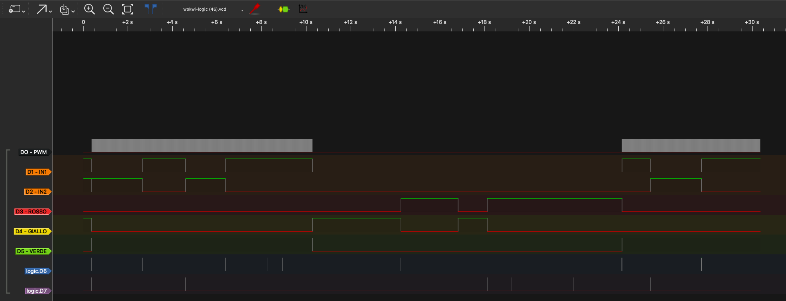

# 12 · Avvicinamento del rover a un ostacolo

Prototipo ESP32-S3 in Wokwi con due sensori HC-SR04, tre LED di stato e un logic analyzer per osservare i segnali destinati al driver del motore.

## Come funziona

Un task simula il backend generando comandi di marcia o di STOP. Il primo comando parte all'avvio, poi l'intervallo tra gli invii varia casualmente da 500 ms a 3 s. Una coda FreeRTOS lunga un elemento conserva il comando più recente.

Il task di controllo legge il sensore frontale per la marcia avanti e quello posteriore per la retromarcia. Con una distanza inferiore a 20 cm o una lettura in timeout, ferma il motore e accende il rosso. Se la marcia è consentita, imposta direzione e PWM e accende il verde. Il comando STOP azzera il PWM e accende il giallo. I comandi di rotazione sono raggruppati per verso di marcia.

Il PWM è generato da LEDC a **1 kHz**, con risoluzione di **10 bit** e duty grezzo casuale fra 64 e 192 durante la marcia.

## Build e simulazione

Dalla cartella dell'esercizio, con ESP-IDF 6.1 installato:

```sh
source "$HOME/.espressif/tools/activate_idf_v6.1.sh"
idf.py -B cmake-build-debug-esp-idf build merge-bin
```

In CLion usa `cmake-build-debug-esp-idf` come directory di build e avvia Wokwi. Per osservare una marcia consentita e una bloccata, imposta un sensore a 80 cm e l'altro sotto i 20 cm. Segui i comandi ricevuti in console e confrontali con il tracciato. Esporta il VCD e aprilo in PulseView con **Downsampling factor = 1** per vedere i singoli impulsi PWM.

| Canale | Segnale |
| --- | --- |
| D0 | PWM motore (GPIO 19) |
| D1 | IN1 (GPIO 20) |
| D2 | IN2 (GPIO 21) |
| D3 | LED rosso |
| D4 | LED giallo |
| D5 | LED verde |
| D6 | ECHO frontale |
| D7 | ECHO posteriore |

## Tracciato in PulseView



Intorno a **10 s**, D0 va a zero, IN1 e IN2 scendono e il LED verde si spegne. Nella fase di arresto si alternano il giallo e il rosso. Intorno a **24 s**, il PWM riparte e il verde si riaccende. Le bande grigie su D0 raggruppano gli impulsi PWM alla scala mostrata. Ingrandendo una banda si possono misurare il periodo e il tempo a livello alto.

## Sviluppi previsti

La lettura della distanza è attivata dai comandi in arrivo. Il prossimo passo è misurare periodicamente durante la marcia, anche quando la coda è vuota.

Gli obiettivi della traccia originale includono lo stop a **20 cm compresi**, lo STOP manuale entro **100 ms**, l'arresto entro **500 ms dall'ultima misura valida** se si perde ECHO e un nuovo START per ripartire. Questi comportamenti restano da implementare o verificare con prove dedicate.

[Manuale ESP32 e FreeRTOS](../../docs/Manuale_API_ESP32_FreeRTOS.html) · [Guida PulseView](../../docs/Manuale_API_ESP32_FreeRTOS.html#pulseview)
